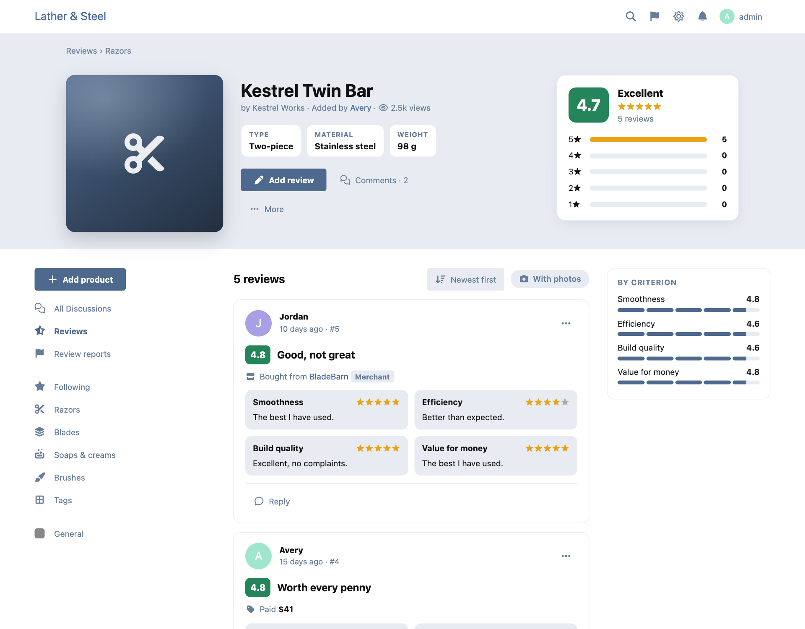
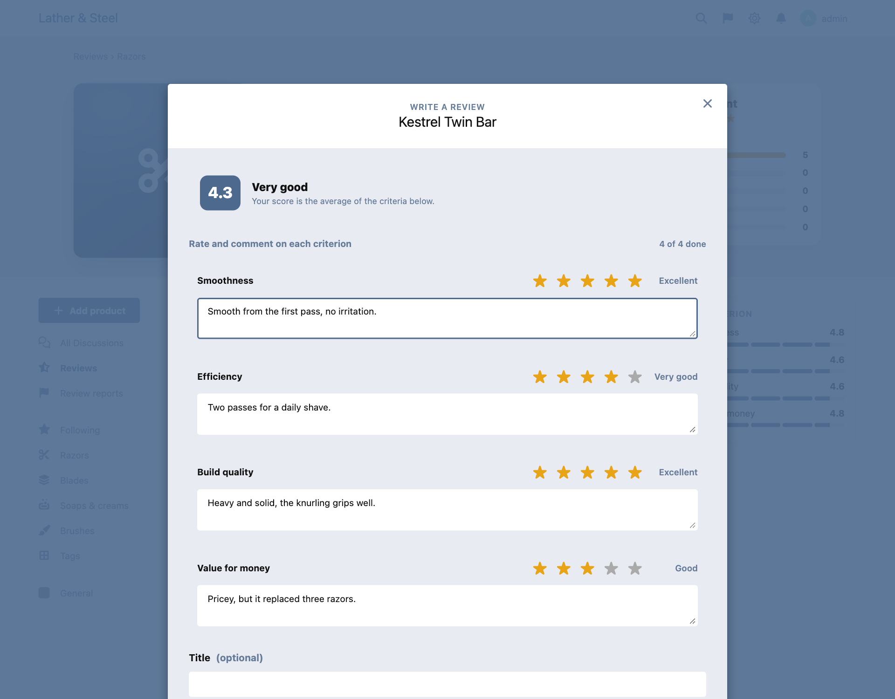
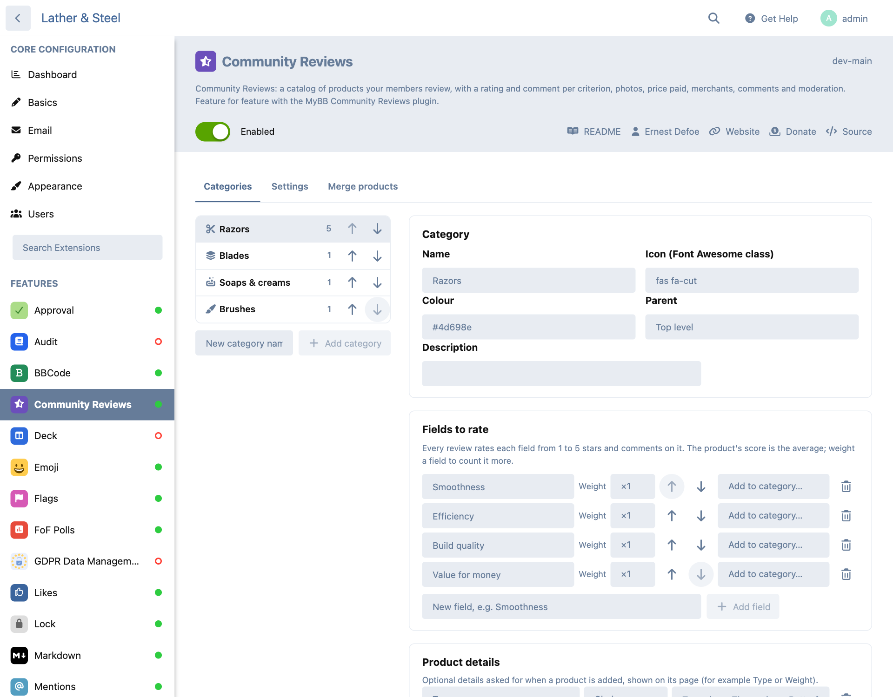

# Community Reviews

A product review catalog for Flarum 2. Your members add the products they use, rate them on the things that matter
in each category, and say why. It does everything the MyBB Community Reviews plugin does, and a little more.


## What it does

- **Categories with their own criteria.** Razors get rated on Smoothness, Efficiency, Build quality and Value; soaps on
  Lather, Slickness and Scent. Every review gives each criterion 1 to 5 stars and a comment, and the product's score is
  the average.
- **Reviews that say something.** Besides the stars there's "General thoughts", the price paid, a link to buy it, the
  merchant it was bought from, and up to four photos (you pick the thumbnail).
- **A product page** with the score, the spread from five stars to one, the average for each criterion, every review,
  and comments that can answer a review.
- **The catalog** sorts by name, rating, number of reviews, views or date added, and searches product names. The home
  page shows recent products, recent reviews and the totals.
- **Merchants.** Pick a group as your Merchants: reviewers can say which member they bought from, the merchant gets a
  notification, and their profile shows those reviews with their average.
- **Moderation.** Report a product, review or comment; moderators get a reports page, can merge duplicate products
  and edit or delete anything. Approval queues for new products and reviews are there when you want them.
- **Notifications** when you're tagged as a merchant, or someone reviews or comments on a product you posted in.





## Extras (all off by default)

Helpful votes, a verified owner badge with how long they've owned it, pros and cons, rich results for search engines
(only on pages guests can see), one review per member per product, and the approval queues. With them all off you get
exactly the MyBB feature set.

## Settings

Everything MyBB's plugin had is in **Admin → Community Reviews**: product order and direction, review and comment
order, products/reviews/comments per page, list lengths, name length limits, the "General thoughts" title and length,
comment length, maximum and required photos, imgur or local photo storage, the Merchants group, and the flood guard.
Who can view, add products, review, comment, vote, edit or delete their own content and moderate is on the permission
grid.



## Install

```sh
composer require ernestdefoe/community-reviews
php flarum migrate
php flarum cache:clear
```

Then add your categories and their criteria in the admin page. Run Flarum's scheduler (`php flarum schedule:run` every
minute from cron) so unused photo uploads are cleaned up daily.

## Update

```sh
composer update ernestdefoe/community-reviews
php flarum migrate
php flarum cache:clear
```

## Works with

[flarum/gdpr](https://github.com/flarum/gdpr): a member's reviews, comments and photos are in their data export, and
anonymised or deleted with them.

## Roadmap

- Compare up to three products side by side.
- The latest reviews as a Page Builder block, a Bespoke zone widget and a FoF widget (the widget under the discussion
  list is already there).
- Renown XP for writing a review (built on Renown's side).

## Links

- [Support forum](https://ernestdefoe.online)
- [Packagist](https://packagist.org/packages/ernestdefoe/community-reviews)
- [Try it on the showcase](https://ernestdefoe.dev/reviews)

MIT licensed. ☕ If you like the things I have built, consider [buying me a coffee](https://buymeacoffee.com/ernestdefoe).
